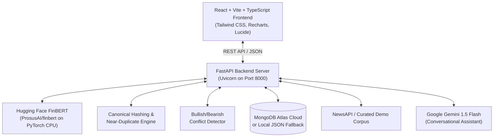

# Financial Market Sentiment Tracker — AI-Powered Financial News Intelligence Platform

A comprehensive college field project engineered for local one-laptop execution. It leverages natural language processing with **Hugging Face `ProsusAI/finbert`** on PyTorch CPU to analyze textual sentiment across financial news headlines, track market divergence, detect narrative conflicts, compute sector heatmaps, and provide explainable AI attribution.

---

## 1. System Architecture



---

## 2. Technology Stack

- **Frontend:** React 19, TypeScript, Vite, Tailwind CSS, Recharts, React Router v6, Lucide Icons, Axios.
- **Backend:** Python 3.10+, FastAPI, Pydantic v2, Uvicorn.
- **AI / NLP:** Hugging Face `ProsusAI/finbert`, Transformers, PyTorch CPU inference (local, no paid inference token needed for sentiment).
- **Attribution / XAI:** Input perturbation word salience (token masking delta \(\Delta P = P_{\text{baseline}} - P_{\text{masked}}\)).
- **Database:** MongoDB Atlas (via PyMongo) with automated local file fallback (`backend/data/local_db.json`).
- **External Integrations:** NewsAPI (live headline retrieval with demo dataset fallback) and Google Gemini API (conversational RAG assistant).

---

## 3. One-Laptop Development Quickstart

### Prerequisites
- Node.js (v18+) and npm
- Python (3.10+)

### Terminal 1: Backend Setup & Execution
```powershell
cd backend

# 1. Activate the Python virtual environment
.\venv\Scripts\Activate.ps1
# (Or on cmd: .\venv\Scripts\activate.bat)

# 2. (Optional) Configure environment variables
# Copy .env.example to .env if you wish to configure live NewsAPI, MongoDB Atlas, or Gemini keys:
copy .env.example .env

# 3. Start the FastAPI server
uvicorn app.main:app --host 127.0.0.1 --port 8000 --reload
```
Backend API will be active at: **`http://127.0.0.1:8000`**
Interactive Swagger docs: **`http://127.0.0.1:8000/docs`**

---

### Terminal 2: Frontend Setup & Execution
```powershell
cd frontend

# Start the Vite development server
npm.cmd run dev
```
Frontend Dashboard will be active at: **`http://localhost:5173`**

---

### Running Automated Test Suite
From the `backend` directory:
```powershell
.\venv\Scripts\python.exe -m pytest app/tests -v
```

---

## 4. Key Platform Features

1. **Local FinBERT Sentiment Engine:**
   - Real-time classification into Bullish (Positive), Neutral, and Bearish (Negative).
   - Returns softmax probability distribution for each class.
   - Zero-dependency on paid inference APIs; runs directly on CPU.

2. **Explainable AI (Perturbation Word Salience):**
   - Automatically identifies tokens whose removal triggers significant probability drops.
   - Includes transparent disclaimer: FinBERT evaluates tone in text; it does not evaluate corporate fundamentals or forecast stock price movements.

3. **Bullish / Bearish Conflict Detector:**
   - Detects securities exhibiting simultaneous positive catalysts and negative headwinds.
   - Displays opposing headlines side-by-side with a configurable divergence index.

4. **Canonical Article Deduplication:**
   - Generates deterministic canonical IDs from normalized headline text and URLs.
   - Identifies near-duplicate syndicated coverage using token Jaccard similarity.
   - Prevents duplicate headlines from artificially inflating dashboard analytics.

5. **Sector Sentiment Heatmap:**
   - Aggregates sentiment across Technology, Financials, Healthcare, Consumer Cyclical, and Energy.
   - Net sentiment polarity score ranging from \(-1.0\) (Bearish) to \(+1.0\) (Bullish).

6. **System Integrity & Data Quality Telemetry:**
   - Continuously audits missing headlines, invalid URLs, duplicate rates, and low-confidence classifications.
   - Reports AI model status, news provider status, and cloud/local persistence mode.

7. **AI Financial News Assistant (Gemini Grounded RAG):**
   - Answers questions strictly grounded in verified news articles and FinBERT metrics.
   - Transparently operates in offline mode if no `GEMINI_API_KEY` is provided.

---

## 5. Environment Variables (`backend/.env`)

```ini
# NewsAPI Key (Optional: falls back to rich demo dataset if empty)
NEWS_API_KEY=

# MongoDB Atlas URI (Optional: falls back to backend/data/local_db.json if empty or unreachable)
MONGODB_URI=
MONGODB_DATABASE=financial_sentiment

# Google Gemini API Key (Optional: assistant disables gracefully if empty)
GEMINI_API_KEY=

# Frontend Origin for CORS
FRONTEND_ORIGIN=http://localhost:5173

# Demo mode override (true/false)
USE_DEMO_DATA=false
```

---

## 6. College Field Project Verification Checklist

- [x] Local FinBERT model weights downloaded and cached (`ProsusAI/finbert`, ~438MB).
- [x] Single-headline classification and batch inference verified.
- [x] 15/15 Backend unit & integration tests passing (`pytest app/tests`).
- [x] Full production frontend bundle compiling cleanly (`tsc -b && vite build`).
- [x] Local JSON database fallback tested without requiring active MongoDB Atlas account.
- [x] Deduplication pipeline and Jaccard similarity tested.
- [x] Bullish/Bearish conflict algorithm tested.
- [x] Polished dark navy financial analytics dashboard with responsive sidebar.
- [x] Explainable AI perturbation modal and limitations disclaimers integrated.
